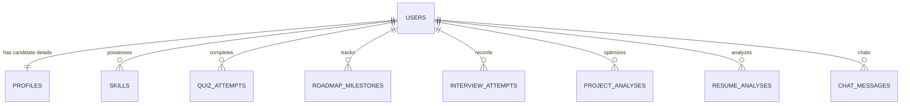

# Database Architecture & Entity Specifications

## PostgreSQL Entity-Relationship Model

The PostgreSQL database schema enforces relational integrity across all candidate placement preparation activities.

### Tables & Relationships

### Table Definitions

1. **`users`**:
   - `id`: `VARCHAR(64)` PRIMARY KEY
   - `name`: `VARCHAR(255)` NOT NULL
   - `email`: `VARCHAR(255)` UNIQUE NOT NULL
   - `password_hash`: `VARCHAR(255)` NOT NULL (Bcrypt)
   - `role`: `VARCHAR(50)` DEFAULT `'student'`
   - `created_at`, `updated_at`: `TIMESTAMP WITH TIME ZONE`

2. **`profiles`**:
   - `id`: `VARCHAR(64)` PRIMARY KEY
   - `user_id`: `VARCHAR(64)` UNIQUE REFERENCES `users(id)` ON DELETE CASCADE
   - `college`, `degree`, `semester`, `gpa`, `target_role`, `daily_study_hours`, `bio`, `github_url`, `linkedin_url`

3. **`skills`**:
   - `id`: `VARCHAR(64)` PRIMARY KEY
   - `user_id`: `VARCHAR(64)` REFERENCES `users(id)` ON DELETE CASCADE
   - `name`: `VARCHAR(100)` NOT NULL
   - `category`: `VARCHAR(50)`
   - `proficiency_level`: `VARCHAR(50)`
   - `verified`: `BOOLEAN` DEFAULT `FALSE`

4. **`quiz_attempts`**:
   - `id`: `VARCHAR(64)` PRIMARY KEY
   - `user_id`: `VARCHAR(64)` REFERENCES `users(id)` ON DELETE CASCADE
   - `category`: `VARCHAR(100)` (aptitude, dsa, dbms, os)
   - `score`, `total_questions`, `percentage`, `time_taken_seconds`, `passed`

5. **`roadmap_milestones`**:
   - `id`: `VARCHAR(64)` PRIMARY KEY
   - `user_id`: `VARCHAR(64)` REFERENCES `users(id)` ON DELETE CASCADE
   - `milestone_key`, `month_index`, `week_index`, `title`, `completed`, `completed_at`
   - UNIQUE constraint on `(user_id, milestone_key)`

6. **`interview_attempts`**:
   - `id`: `VARCHAR(64)` PRIMARY KEY
   - `user_id`: `VARCHAR(64)` REFERENCES `users(id)` ON DELETE CASCADE
   - `role`, `question`, `user_answer`, `ai_score`, `feedback`, `communication_rating`, `missing_concepts`, `follow_up_question`

7. **`project_analyses`**:
   - `id`: `VARCHAR(64)` PRIMARY KEY
   - `user_id`: `VARCHAR(64)` REFERENCES `users(id)` ON DELETE CASCADE
   - `title`, `description`, `tech_stack`, `complexity_score`, `star_bullets` (JSONB), `viva_questions` (JSONB)

8. **`resume_analyses`**:
   - `id`: `VARCHAR(64)` PRIMARY KEY
   - `user_id`: `VARCHAR(64)` REFERENCES `users(id)` ON DELETE CASCADE
   - `file_name`, `target_role`, `extracted_text`, `ats_score`, `parsed_skills` (JSONB), `missing_keywords` (JSONB), `suggestions` (JSONB)
